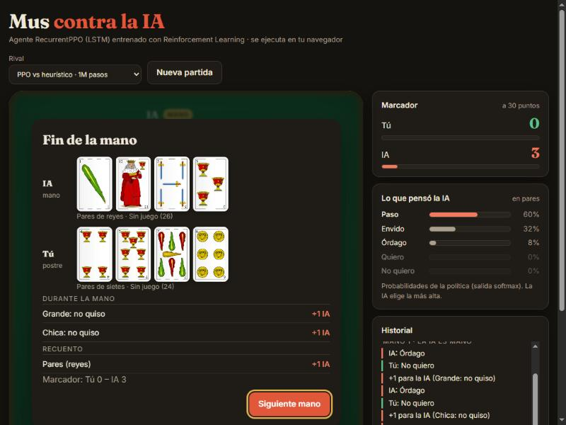

# Mus · Reinforcement Learning

Agentes que aprenden a jugar al **Mus**, el juego de cartas español, mediante
Reinforcement Learning. El proyecto incluye:

- **`mus_gym`**: el Mus (1 contra 1) implementado como entorno de [Gymnasium](https://gymnasium.farama.org/).
- **Agentes RecurrentPPO (LSTM)** entrenados con [sb3-contrib](https://sb3-contrib.readthedocs.io/): contra un bot heurístico, por self-play y por currículum.
- **Demo web jugable**: la red neuronal se ejecuta en el navegador (JavaScript puro, sin servidor).
- **Juego de escritorio** en pygame y scripts de entrenamiento y evaluación.

<p align="center">
  
</p>

## ▶️ Jugar

**Online:** <https://rujormo2003.github.io/mus_Reinforcement_Learning/> (GitHub Pages, ver [Publicar la demo](#publicar-la-demo)).

**En local, en el navegador:**

```bash
python -m http.server 8000 --directory web
```

y abre <http://localhost:8000>.

**En local, con pygame:**

```bash
pip install -r requirements.txt
python scripts/play_pygame.py                          # rival por defecto: ppo_LinearDecay
python scripts/play_pygame.py --model models/ppo_vs_heuristic.zip
```

## 🃏 La versión del Mus que se juega

Es una versión simplificada para dos jugadores (el Mus real es 2 contra 2):

| Regla | Implementación |
|---|---|
| Jugadores | 1 contra 1, partida a 30 puntos |
| Baraja | 40 cartas, **8 reyes** (el 3 vale como rey y el 2 como as) |
| Fase de mus (descarte) | No existe: se juega con las 4 cartas repartidas |
| Lances | Grande → Chica → Pares → Juego |
| Apuestas | `Paso`, `Envido` (fijo, 2 piedras), `Órdago`, `Quiero`, `No quiero` |
| Pares / Juego | Solo se apuestan si ambos tienen; si solo uno tiene, gana 1 punto + su bonus |
| Punto | Si nadie tiene juego, el lance no se juega |
| Recuento | Grande/Chica en paso: +1 · envite visto: +2 · pares: 1/2/3 · juego: 3 (31) o 2 |
| Órdago aceptado | Se resuelve al momento; el ganador del lance gana la partida |
| Empates | Gana el jugador *mano* (que alterna cada mano) |

## 🧠 El entorno `mus_gym`

```python
import gymnasium as gym
import mus_gym  # registra Mus-v0 … Mus-v3

env = gym.make("Mus-v1")            # el agente (J0) contra el HeuristicBot (J1)
obs, info = env.reset(seed=0)
done = False
while not done:
    action = env.action_space.sample()
    obs, reward, terminated, truncated, info = env.step(action)
    done = terminated or truncated
print(env.unwrapped.scores, "ganador:", env.unwrapped.winner)
```

| ID | Clase | Rival del agente |
|---|---|---|
| `Mus-v0` | `MusEnvironment` | Ninguno: ambos jugadores se controlan desde fuera |
| `Mus-v1` | `MusEnvConBots` | `HeuristicBot` (o cualquier bot con `bot=...`) |
| `Mus-v2` | `MusEnvCurriculum` | Modelo SB3 congelado (`opponent_policy=...`) |
| `Mus-v3` | `MusEnvSelfPlay` | Modelo cargado de un `.zip`, actualizable en caliente (`opponent_path=...`) |

- **Acciones** (`Discrete(5)`): `0 PASO`, `1 ENVIDO`, `2 ÓRDAGO`, `3 QUIERO`, `4 NO_QUIERO`. Una acción ilegal se sustituye por una legal al azar.
- **Observación** (`Box(8,)`): nº de reyes, nº de ases, tipo de pares, fuerza del juego, lance actual, estado de la apuesta, si es mano y diferencia de marcador. Detalle en [`mus_observation.py`](mus_gym/mus_observation.py).
- **Recompensa**: `±1` al ganar/perder la partida más un pequeño *shaping* `0.1 · Δ(diferencia de puntos) / 30` en cada paso.

La arquitectura completa (motor, flujo de una mano, wrappers, pipeline de entrenamiento y demo web) está en **[docs/ARCHITECTURE.md](docs/ARCHITECTURE.md)**.

## 📈 Modelos y resultados

Todos son `RecurrentPPO` con política `MlpLstmPolicy` y están en [`models/`](models/).

| Modelo | Entrenamiento | Pasos | Red |
|---|---|---|---|
| `ppo_vs_heuristic` | Contra `HeuristicBot` (`Mus-v1`) | 1.0M | LSTM 128 + MLP 128×2 |
| `ppo_selfplay` | Liga self-play desde el anterior (`Mus-v3`) | 3.0M | LSTM 128 + MLP 128×2 |
| `ppo_colab_selfplay` | Currículum en Colab: `SheriffBot` → self-play | 7.0M | LSTM 256 + MLP 256×2 |
| `ppo_Baseline` | Estudio de hiperparámetros: LR constante 3e-4 | 8.5M | LSTM 256 + MLP 256×2 |
| `ppo_LinearDecay` | Estudio de hiperparámetros: LR con decaimiento lineal | 8.5M | LSTM 256 + MLP 256×2 |
| `ppo_HighEntropy` | Estudio de hiperparámetros: `ent_coef=0.05`, `clip=0.1` | 8.5M | LSTM 256 + MLP 256×2 |

**Porcentaje de victorias** (300 partidas por rival, `python scripts/evaluate.py -n 300`):

| Modelo | vs aleatorio | vs `HeuristicBot` | vs `SheriffBot` |
|---|---|---|---|
| `ppo_vs_heuristic` | 61.7% | **64.0%** | **60.3%** |
| `ppo_colab_selfplay` | 62.0% | 58.3% | 46.0% |
| `ppo_LinearDecay` | **63.0%** | 55.3% | 38.7% |
| `ppo_HighEntropy` | 58.3% | 57.0% | 39.7% |
| `ppo_Baseline` | 58.0% | 52.3% | 43.0% |
| `ppo_selfplay` | 58.7% | 51.7% | 42.7% |
| *Referencia: bot aleatorio* | 50.0% | 47.9% | 37.4% |
| *Referencia: `SheriffBot`* | 63.8% | 46.4% | 48.2% |

Lecturas:

- Todos los agentes superan al azar. El `HeuristicBot` juega casi como un agente aleatorio porque **casi nunca acepta un órdago**, así que farolear con órdagos es muy rentable contra él. Por eso en Colab se añadió el `SheriffBot`, que sí los acepta con manos medias.
- El modelo más pequeño (`ppo_vs_heuristic`) es el más robusto en esta evaluación. Los modelos entrenados más tiempo por self-play aprenden a explotarse entre sí (sobre todo con órdagos en Chica) y generalizan peor a otros rivales.
- Las curvas de entrenamiento están en [`logs/`](logs/) (`tensorboard --logdir logs`) y los gráficos de duración vs. resultado en [`results/evaluation/`](results/evaluation/).

## 🏋️ Entrenar

```bash
pip install -r requirements.txt

# 1) Contra el bot heurístico
python scripts/train_vs_heuristic.py --timesteps 1000000

# 2) Self-play tipo liga a partir de un modelo
python scripts/train_self_play.py --init models/ppo_vs_heuristic.zip --timesteps 2000000

# Evaluar (todos los modelos de models/ o los que indiques)
python scripts/evaluate.py models/ppo_vs_heuristic.zip -n 500 --plots
```

El currículum de Colab (fase `SheriffBot` → self-play → "terapia de corrección") y el estudio
de hiperparámetros están en [`notebooks/`](notebooks/).

## 🌐 Demo web

La carpeta [`web/`](web/) es una página estática:

- [`js/mus-engine.js`](web/js/mus-engine.js): port del motor de `mus_gym` a JavaScript (mismas reglas y misma observación).
- [`js/policy.js`](web/js/policy.js): la LSTM + MLP de la política, ejecutada en JS con los pesos exportados.
- [`models/`](web/models/): pesos exportados con `scripts/export_web_policy.py` (`.bin` float32 + `.json`).

La fidelidad está verificada: los logits de JS coinciden con PyTorch (error < 1e-5, se comprueba al cargar
cada modelo; ver la consola del navegador) y el motor JS reproduce paso a paso 300 partidas generadas con el de Python.

Para añadir otro modelo a la demo:

```bash
python scripts/export_web_policy.py models/ppo_Baseline.zip
```

y añádelo a la lista `MODELS` de [`web/js/app.js`](web/js/app.js).

### Publicar la demo

1. El repositorio debe ser **público**: en el plan gratuito de GitHub, Pages no está disponible para
   repos privados (mientras sea privado, el workflow se salta sin fallar).
2. En **Settings → Pages**, elige **Source: GitHub Actions**.
3. Cada push a `main` que toque `web/` la publica con [`.github/workflows/pages.yml`](.github/workflows/pages.yml)
   (también se puede lanzar a mano desde la pestaña *Actions*).

## 📂 Estructura

```
├── mus_gym/                 Paquete del entorno
│   ├── mus_env.py           Motor del juego (MusEnvironment, Mus-v0)
│   ├── mus_opponent_env.py  Entornos de un agente vs rival (Mus-v1, v2, v3)
│   ├── mus_rules.py         Quién gana cada lance y puntos de pares/juego
│   ├── mus_entities.py      Carta, Baraja, Mano
│   ├── mus_observation.py   Vector de observación (8 features)
│   ├── mus_bots.py          HeuristicBot y SheriffBot
│   ├── mus_enums.py         Acciones, lances y estados
│   └── mus_config.py        Palos, rangos y valores
├── scripts/                 Entrenar, evaluar, jugar (pygame) y exportar a la web
├── notebooks/               Entrenamiento en Colab y estudio de hiperparámetros
├── models/                  Modelos entrenados (.zip de SB3)
├── logs/                    Logs de TensorBoard de cada fase
├── results/evaluation/      Gráficos de evaluación
├── web/                     Demo jugable en el navegador
├── assets/cartas/           Imágenes de la baraja (pygame)
├── tests/                   Tests de reglas y entornos (pytest)
└── docs/                    Documentación de arquitectura
```

## ✅ Tests

```bash
python -m pytest
```

## Licencia

El código está bajo licencia [MIT](LICENSE). Las imágenes de las cartas tienen su propia licencia
(CC BY-SA 3.0), indicada abajo.

## Créditos

- Imágenes de las cartas: [«Baraja española completa»](https://commons.wikimedia.org/wiki/File:Baraja_espa%C3%B1ola_completa.png) de Basquetteur, basada en [«Baraja española.svg»](https://commons.wikimedia.org/wiki/File:Baraja_espa%C3%B1ola.svg) de Germarquezm, bajo licencia [CC BY-SA 3.0](https://creativecommons.org/licenses/by-sa/3.0/deed.es). Recortadas y, para la web, redimensionadas a WebP. Detalles en [assets/cartas/CREDITS.md](assets/cartas/CREDITS.md).
- Construido con Gymnasium, Stable-Baselines3 y sb3-contrib.
