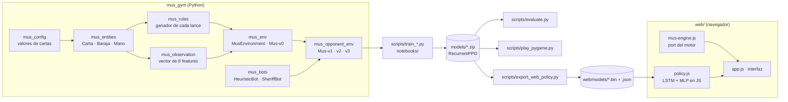
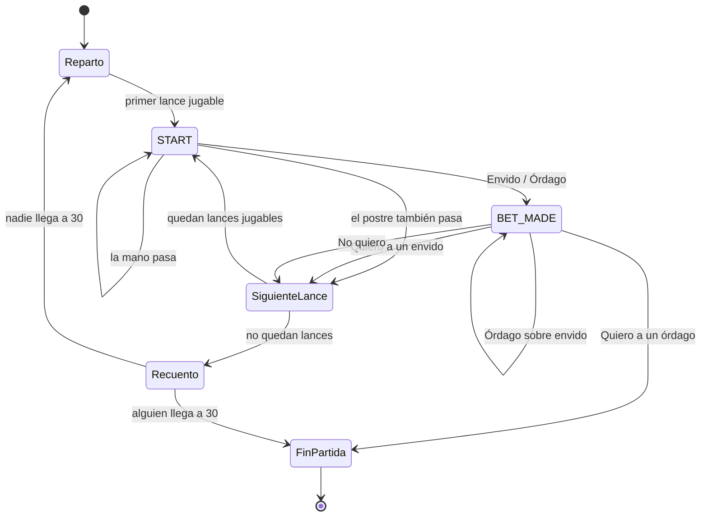
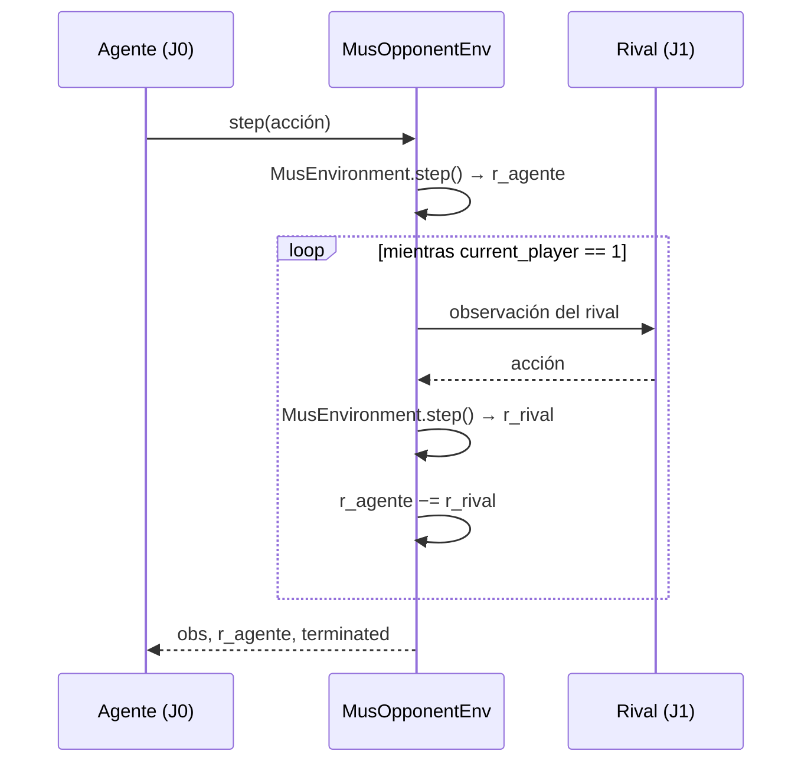
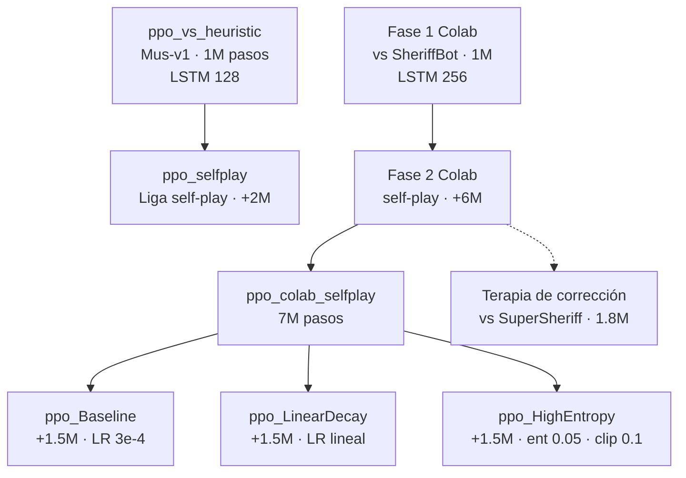

# Arquitectura

Este documento explica cómo encajan las piezas del proyecto: el motor del juego,
los entornos de Gymnasium, los agentes, el pipeline de entrenamiento y la demo web.



## 1. Motor del juego (`mus_gym/mus_env.py`)

`MusEnvironment` es un `gymnasium.Env` por turnos para **dos jugadores** (índices `0` y `1`).
No sabe quién controla a cada jugador: en cada `step()` actúa el jugador
`current_player_idx`.

### Estado principal

| Atributo | Significado |
|---|---|
| `manos[0..1]` | `Mano` de cada jugador (4 cartas) |
| `scores[0..1]` | Puntos acumulados en la partida |
| `mano_player_idx` | Quién es *mano* (habla primero y gana empates). Alterna cada mano |
| `current_lance` | `GRANDE`, `CHICA`, `PARES` o `JUEGO` |
| `current_lance_state` | `START` (nadie ha apostado) o `BET_MADE` (hay apuesta pendiente) |
| `lance_bet`, `last_valid_bet`, `player_who_bet` | Apuesta en curso |
| `pending_bets[lance]` | Lo que se cobra en el recuento: `0` paso, `>0` envite visto, `-1` ya cobrado por *no quiero*, `-2` lance sin disputa |
| `game_over`, `winner` | Fin de partida |

### Flujo de una mano



- **Pares y Juego** pasan por `_auto_resolve_lance()`: si no los tienen ambos jugadores, el lance se salta;
  si solo uno tiene, se lleva 1 punto inmediato y su bonus en el recuento.
- **Recuento** (`_resolve_showdown()`): Grande/Chica en paso dan 1 punto al ganador; los envites vistos
  se cobran; Pares y Juego suman además su bonus (`mus_rules.pares_points` / `juego_points`).
- **Órdago aceptado**: el ganador del lance pasa directamente a `target_score` puntos.

### Reglas de comparación (`mus_rules.py`)

| Lance | Gana | Empate |
|---|---|---|
| Grande | Comparación lexicográfica de cartas ordenadas de mayor a menor | Mano |
| Chica | Comparación lexicográfica de cartas de menor a mayor (gana la más baja) | Mano |
| Pares | `(Duples > Medias > Pares, valor principal, valor secundario)` | Mano |
| Juego | Tener juego; entre juegos `31 > 32 > 40 > 37 > … > 33` | Mano |

Con la variante de **8 reyes** (`mus_config.VALORES_COMPARACION`) los treses valen como reyes y los doses como ases.

### Recompensa

Calculada en `MusEnvironment._compute_reward()` desde la perspectiva del jugador que acaba de actuar:

```
r = 0.1 · (Δ puntos propios − Δ puntos rival) / 30   (+1 si gana la partida, −1 si la pierde)
```

Es de suma cero: lo que gana un jugador lo pierde el otro. Los wrappers de un agente restan la
recompensa que obtiene el rival en sus turnos.

> **Nota histórica.** Los modelos se entrenaron con una recompensa distinta, definida por apuesta
> (ver `git show fac5329^:mus_gym/mus_env.py`):
>
> - `Quiero`: quien responde recibe `±puntos_apostados / 30` según gane o pierda el lance.
> - `No quiero`: quien responde recibe `−1 / 30`.
> - Acción ilegal: `−1` (y se sustituye por una legal al azar).
>
> En el commit `fac5329` se reescribió el motor (recuento al final de la mano, *pending bets*) y esa
> recompensa quedó comentada, de modo que `step()` pasó a devolver siempre `0` y los scripts de
> entrenamiento dejaron de poder aprender. La recompensa actual (±1 terminal + *shaping*) la sustituye
> y está adaptada al motor nuevo.

## 2. Observación (`mus_observation.py`)

Vector `float32` de 8 componentes, siempre desde la perspectiva del jugador que va a decidir:

| # | Feature | Codificación |
|---|---|---|
| 0 | Reyes | nº de reyes (incl. treses) / 4 |
| 1 | Ases | nº de ases (incl. doses) / 4 |
| 2 | Pares | 0 · 0.33 · 0.66 · 1 (nada, pares, medias, duples) |
| 3 | Juego | posición en `[33, 34, 35, 36, 37, 40, 32, 31]` / 8; 0 sin juego |
| 4 | Lance | 0 · 0.33 · 0.66 · 1 |
| 5 | Apuesta | 0 sin apuesta · 0.5 envido · 1 órdago |
| 6 | Soy mano | 1 / 0 |
| 7 | Marcador | (mis puntos − rival) / 30 |

Es una representación muy compacta: el agente no ve sus cartas concretas, ni el historial de apuestas
(salvo a través de la memoria de la LSTM). Es la principal limitación del agente y el primer punto a
mejorar (ver [Ideas de mejora](#6-ideas-de-mejora)).

> Cambiar esta codificación invalida los modelos entrenados y obliga a actualizar también
> `web/js/mus-engine.js`.

## 3. Entornos de un agente (`mus_opponent_env.py`)

`MusOpponentEnv` convierte el juego de dos jugadores en un entorno de un solo agente: el agente es
siempre el **jugador 0** y, tras cada acción suya, el rival (jugador 1) juega todos sus turnos hasta que
vuelve a tocar al agente.



| Clase | ID | Rival |
|---|---|---|
| `MusEnvConBots` | `Mus-v1` | Un bot con `choose_action(dict)` (por defecto `HeuristicBot`) |
| `MusEnvCurriculum` | `Mus-v2` | Un modelo SB3 ya cargado (`predict`, determinista y sin estado LSTM) |
| `MusEnvSelfPlay` | `Mus-v3` | Igual que v2 pero carga el `.zip` y expone `update_opponent_model(path)` para los callbacks |

### Bots (`mus_bots.py`)

- **`HeuristicBot`**: estima la "fuerza" de su mano en el lance actual (0–1) y decide con umbrales:
  envida por encima de 0.45–0.60, ordaga por encima de 0.9, hace faroles con probabilidad 0.15 y solo
  acepta órdagos con fuerza ≥ 0.95. Esa prudencia ante el órdago lo hace muy explotable.
- **`SheriffBot`**: igual, pero acepta órdagos con fuerza > 0.40 (o > 0.25, el "SuperSheriff").
  Se creó para castigar los órdagos indiscriminados que aprendía la IA.

## 4. Pipeline de entrenamiento

Todos los agentes son `RecurrentPPO` (`MlpLstmPolicy`): una LSTM da memoria dentro de la partida
(qué ha apostado el rival en lances anteriores) y dos MLP separadas para actor y crítico.



| Fase | Código | Logs |
|---|---|---|
| Contra bot heurístico | `scripts/train_vs_heuristic.py` | `logs/01_vs_heuristic` |
| Liga self-play (rey de la colina: el aspirante sustituye al campeón si su recompensa media > 0.05) | `scripts/train_self_play.py` | `logs/02_selfplay_league` |
| Currículum Colab: Sheriff → self-play (rival actualizado cada 100k pasos) → corrección | `notebooks/train_colab.ipynb` | `logs/03_colab_curriculum` |
| Estudio de hiperparámetros contra el modelo de 7M congelado | `notebooks/hyperparameter_study.ipynb` | `logs/04_hyperparameters` |

Hiperparámetros principales:

| | Fase local (128) | Fase Colab (256) |
|---|---|---|
| `learning_rate` | 2e-4 | 3e-4 |
| `n_steps` / `batch_size` | 256 / 128 | 512 / 512 |
| `gamma` | 0.995 | 0.995 |
| `ent_coef` | 0.05 | 0.03 → 0.01 |
| Entornos paralelos | 8 | 16 |

## 5. Demo web (`web/`)

Página estática sin dependencias ni build, publicable en GitHub Pages.

- **`mus-engine.js`** replica `MusEnvironment` regla por regla y la misma observación. Además emite
  eventos (`action`, `points`, `skip`, `hand_end`, `game_over`…) para que la interfaz muestre el recuento.
- **`policy.js`** implementa la parte actor de la política de SB3:
  `obs → LSTM (puertas i, f, g, o de PyTorch) → [Linear + tanh] × 2 → action_net → softmax`.
  El estado LSTM se reinicia al empezar cada partida y solo avanza en los turnos de la IA, igual que en
  la evaluación con `model.predict(..., state, episode_start)`.
- **`export_web_policy.py`** vuelca los pesos del actor (`lstm_actor`, `mlp_extractor.policy_net`,
  `action_net`) a un `.bin` float32 y guarda en el `.json` doce casos de prueba calculados con PyTorch.
  Al cargar un modelo, `LstmPolicy.selfTest()` los recalcula en JS y escribe el error máximo en la consola.
- La IA juega en modo determinista (argmax). Si elige una acción ilegal se sustituye por una legal al azar,
  como en entrenamiento; el panel "Lo que pensó la IA" lo indica.

## 6. Ideas de mejora

- **Observación más rica**: cartas concretas (one-hot de 8 valores), historial de apuestas de la mano, quién envidó.
- **Enmascarar acciones ilegales** (`MaskablePPO` o máscara en los logits) en vez de sustituirlas al azar.
- **Mus completo**: fase de mus/descarte, envites de cantidad variable, 2 contra 2 con señas.
- **Liga con varios rivales** (modelos antiguos + bots) para evitar que el self-play se sobreespecialice.
